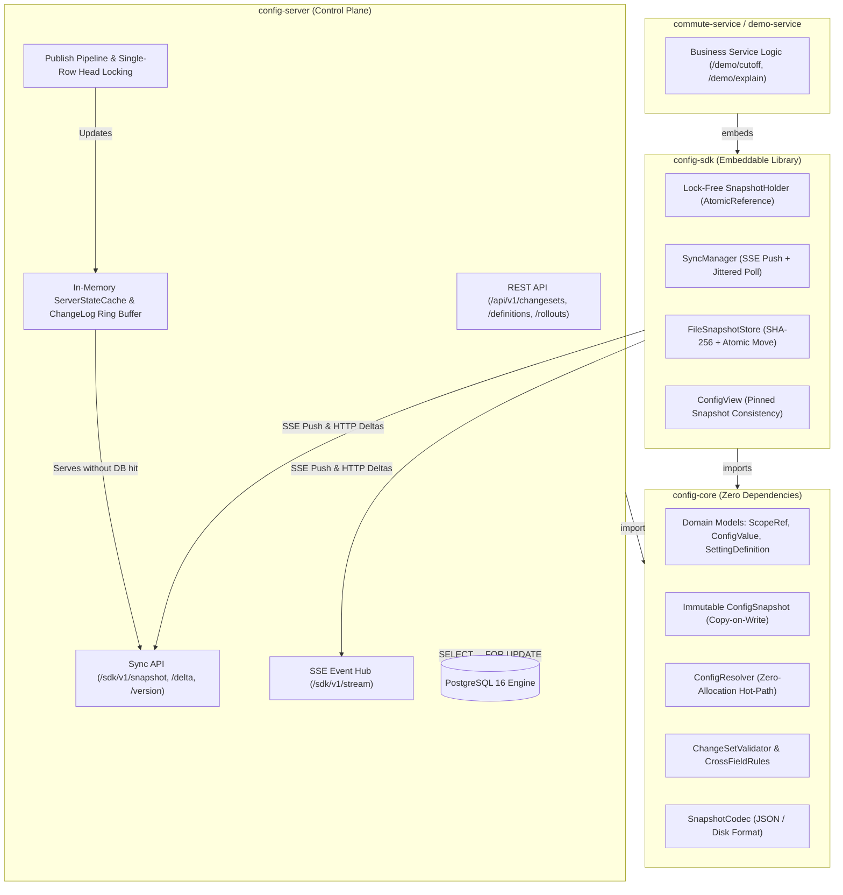

# MoveInSync Hierarchical Tenant Configuration Platform

[](https://openjdk.org/projects/jdk/21/)
[](https://spring.io/projects/spring-boot)
[](https://www.postgresql.org/)
[]()

An enterprise-grade, distributed multi-tenant hierarchical configuration management platform engineered for commute and fleet operations. The system provides sub-microsecond in-memory configuration resolution, multi-tier override inheritance, atomic change-sets, staged canary rollouts, instant rollbacks, and real-time distributed synchronization across microservices via Server-Sent Events (SSE).

---

## Table of Contents

- [System Architecture](#system-architecture)
- [Core Architectural Guarantees](#core-architectural-guarantees)
- [Hierarchical Scope Resolution](#hierarchical-scope-resolution)
- [Repository Structure](#repository-structure)
- [Quick Start](#quick-start)
- [End-to-End Walkthrough (cURL)](#end-to-end-walkthrough-curl)
  - [1. Mint Dev Tokens](#1-mint-dev-tokens)
  - [2. Register Setting Definition](#2-register-setting-definition)
  - [3. Publish Configuration Overrides](#3-publish-configuration-overrides)
  - [4. Query Demo Service Lookups & Explainability](#4-query-demo-service-lookups--explainability)
  - [5. Staged Canary Rollout Lifecycle](#5-staged-canary-rollout-lifecycle)
  - [6. Rollback Preview & Execution](#6-rollback-preview--execution)
  - [7. Verify Tenant Isolation (404 Non-Discovery)](#7-verify-tenant-isolation-404-non-discovery)
  - [8. Prometheus Observability](#8-prometheus-observability)
  - [9. Automated Failure Injection Test](#9-automated-failure-injection-test)
- [Benchmark Reports & Empirical Results](#benchmark-reports--empirical-results)
- [API Reference](#api-reference)
- [SDK Integration Guide](#sdk-integration-guide)
- [Technical Documentation Deliverables](#technical-documentation-deliverables)

---

## System Architecture



---

## Core Architectural Guarantees

| Area | Architectural Decision & Mechanism | Guarantee |
|---|---|---|
| **Linearizable Monotonic Versions** | Single-row `config_head` table locked with `SELECT ... FOR UPDATE` on publish | Gap-free, strictly increasing commit-ordered versions $V_{k+1} = V_k + 1$. Prevents DB sequence commit reordering. |
| **Notification Safety** | SSE push carries **strictly version numbers** (`event: version\ndata: {"version": N}`) | Zero risk of out-of-order data corruption. Clients apply state exclusively from delta/snapshot sync responses. |
| **Tear-Free Reads** | `ConfigView` pins an immutable snapshot reference for the duration of a request | Zero locking, zero mutex contention, zero torn reads across interdependent keys (e.g. `start < end`). |
| **Zero-DB Sync Path** | In-memory `ServerStateCache` (Caffeine) + 1,000-entry ring buffer `ChangeLog` | Snapshot, delta, and version endpoints serve 100% from memory with zero database queries during reconnect storms. |
| **Staged Canary Rollouts** | Reuses standard scope hierarchy (`rollout_id` tagged `OFFICE` overrides) | Target offices observe new values; sibling offices fall back to `CLIENT`/`GLOBAL`. Promotion writes client scope and cleans office overrides. |
| **Database Reset Recovery** | `epoch` UUID stored in `config_head` and cached by SDK | If the server DB is wiped or restored from backup, the SDK detects the epoch mismatch, resets its watermark, and fetches a fresh snapshot. |
| **Tenant Isolation & Security** | Cross-tenant access returns **`404 Not Found`** (never 403) | Conceals tenant existence from unauthorized callers. All logs scrub emails/phones via `LogSanitizer`. |
| **Disk Cache Resiliency** | Temporary atomic write (`.tmp`) + `fsync` + SHA-256 validation | Guards against power outages and partial writes. Verified in `FileSnapshotStore`. |

---

## Hierarchical Scope Resolution

Configurations are evaluated along a specificity chain from most specific to least specific:

$$\text{SHIFT} \longrightarrow \text{OFFICE} \longrightarrow \text{CLIENT} \longrightarrow \text{GLOBAL} \longrightarrow \text{Definition Default}$$

```mermaid
flowchart TD
    Req["ConfigContext: [client=acme, office=acme/blr-1, shift=acme/blr-1/night]"]
    S0["1. SHIFT: acme/blr-1/night"]
    S1["2. OFFICE: acme/blr-1"]
    S2["3. CLIENT: acme"]
    S3["4. GLOBAL"]
    Def["5. Definition Default"]
    Found["Return Resolved ConfigValue"]

    Req --> S0
    S0 -- Override present? -->|Yes| Found
    S0 -- No --> S1
    S1 -- Override present? -->|Yes| Found
    S1 -- No --> S2
    S2 -- Override present? -->|Yes| Found
    S2 -- No --> S3
    S3 -- Override present? -->|Yes| Found
    S3 -- No --> Def
    Def --> Found
```

### Zero-Allocation Hot-Path Lookups
- `ConfigContext` precomputes its lookup chain array `[SHIFT, OFFICE, CLIENT, GLOBAL]` once upon construction.
- `ConfigResolver.resolveValue(snapshot, key, context)` executes at most 4 array dereferences and hash-map lookups, returning the raw `ConfigValue` directly with **zero heap allocations**.

### Polymorphic Type Safety & Cross-Field Validation
- **Supported Value Types**: `NUMBER`, `DURATION`, `TIME_WINDOW`, `ENUM`, `LIST`.
- **Cross-Field Rules**:
  - `StartBeforeEndRule`: Enforces `start_offset < end_offset` for window configurations.
  - `MinLessThanMaxRideTimeRule`: Validates minimum commute duration is strictly less than maximum commute duration.
  - `CutoffWithinLeadTimeRule`: Verifies booking cut-off times do not exceed lead time boundaries.

---

## Repository Structure

```
hierarchical-config/
├── pom.xml                                  # Maven parent configuration
├── docker-compose.yml                       # Multi-container orchestration (Postgres, Server, Demo)
├── README.md                                # Platform documentation & walkthrough
├── docs/
│   ├── design-note.md                       # Architectural design note & sequence diagrams
│   ├── consistency-model.md                 # Linearizability, snapshot isolation & watermark sync
│   ├── failure-modes.md                     # Comprehensive failure analysis & mitigation matrix
│   └── benchmarks.md                        # Empirical benchmark measurements (HdrHistogram)
├── scripts/
│   ├── mint-token.sh                        # Shell helper to generate signed JWTs
│   └── kill-server-test.sh                  # Failure injection & offline resilience script
├── config-core/                             # Pure Java domain models, codecs, validators & resolver
│   └── src/main/java/com/moveinsync/config/core/
│       ├── model/                           # ScopeRef, ConfigSnapshot, ConfigContext, ConfigResolver
│       ├── values/                          # Sealed ConfigValue hierarchy & TypeHandlers
│       ├── validation/                      # ChangeSetValidator & CrossFieldRules
│       └── codec/                           # SnapshotCodec (JSON / Disk format)
├── config-server/                           # Spring Boot 3 control plane
│   ├── src/main/java/com/moveinsync/config/server/
│   │   ├── controller/                      # ChangeSet, Definition, Rollout, Rollback, Sync & DevToken
│   │   ├── service/                         # Publish pipeline, RolloutService, RollbackService
│   │   ├── cache/                           # ServerStateCache (Caffeine) & ChangeLog ring buffer
│   │   ├── propagation/                     # SseConnectionRegistry, SseSession, OutboxPublisher
│   │   ├── repository/                      # JDBC repositories with SELECT ... FOR UPDATE
│   │   └── security/                        # JwtService, JwtAuthFilter, TenantGuard, LogSanitizer
│   └── src/main/resources/db/migration/     # Flyway schema migrations (V1__init.sql)
├── config-sdk/                              # High-performance embeddable client library
│   └── src/main/java/com/moveinsync/config/sdk/
│       ├── ConfigClient.java                # Client lifecycle, builder & listener dispatch
│       ├── ConfigView.java                  # Pinned snapshot isolation for tear-free reads
│       ├── sync/                            # SyncManager (SSE stream + jittered polling)
│       └── store/                           # FileSnapshotStore (atomic temp write + SHA-256)
├── demo-service/                            # Sample commute booking service embedding the SDK
│   └── src/main/java/com/moveinsync/demo/   # DemoController (/demo/cutoff, /demo/explain, /demo/stats)
└── load-tests/                              # High-concurrency benchmarks & failure injection tests
    └── src/test/java/com/moveinsync/load/
        ├── ResolverBenchmarkTest.java       # Local read throughput & HdrHistogram latencies
        ├── AtomicChangeSetConcurrencyTest.java # 38M+ reads verifying 0 torn reads
        ├── PropagationLoadTest.java         # 50 clients measuring commit-to-applied latency
        ├── ReconnectStormTest.java          # 100 simultaneous clients thundering herd
        └── FailureInjectionTest.java        # Offline memory & disk cache serving during outage
```

---

## Quick Start

### Prerequisites
- **Java 21** or later
- **Maven 3.9+** (or use `./mvnw`)
- **Docker & Docker Compose**

### 1. Build & Run All Tests
```bash
./mvnw clean test
```
*Executes all 45 unit, integration, and concurrency tests across all 5 modules with 0 failures.*

### 2. Start Services via Docker Compose
```bash
docker-compose up --build -d
```
*Spins up PostgreSQL 16 (`5432`), Config Server (`8080`), and Demo Service (`8081`).*

Verify running containers:
```bash
docker-compose ps
```

---

## End-to-End Walkthrough (cURL)

### 1. Mint Dev Tokens
Mint an `ADMIN` token for control plane operations and a `SERVICE` token restricted to tenant `acme`:

```bash
# Mint an ADMIN token
ADMIN_TOKEN=$(curl -s -X POST http://localhost:8080/dev/token \
  -H "Content-Type: application/json" \
  -d '{"subject":"admin-operator","roles":["ADMIN","OPERATOR"],"tenants":["*"]}' | grep -o '"token":"[^"]*' | cut -d'"' -f4)

# Mint a SERVICE token restricted to tenant 'acme'
SERVICE_TOKEN=$(curl -s -X POST http://localhost:8080/dev/token \
  -H "Content-Type: application/json" \
  -d '{"subject":"commute-service-1","roles":["SERVICE"],"tenants":["acme"]}' | grep -o '"token":"[^"]*' | cut -d'"' -f4)

echo "Admin Token: $ADMIN_TOKEN"
echo "Service Token: $SERVICE_TOKEN"
```

---

### 2. Register Setting Definition
Create a new setting definition with strict enum validation rules:

```bash
curl -i -X POST http://localhost:8080/api/v1/definitions \
  -H "Authorization: Bearer $ADMIN_TOKEN" \
  -H "Content-Type: application/json" \
  -d '{
    "key": "escort.guard.required",
    "type": "ENUM",
    "defaultValue": "DISABLED",
    "rules": {
      "allowedValues": ["DISABLED", "FEMALE_ONLY", "ALL_EMPLOYEES"]
    },
    "description": "Security escort guard policy for night shifts",
    "reason": "Security compliance onboarding"
  }'
```

---

### 3. Publish Configuration Overrides
Publish a change set overriding `booking.cutoff` for office `acme/blr-1` to 45 minutes:

```bash
curl -i -X POST http://localhost:8080/api/v1/changesets \
  -H "Authorization: Bearer $ADMIN_TOKEN" \
  -H "Content-Type: application/json" \
  -d '{
    "reason": "Extend booking cutoff for BLR-1 campus",
    "items": [
      {
        "settingKey": "booking.cutoff",
        "scope": {"type": "OFFICE", "id": "acme/blr-1"},
        "value": 45
      }
    ],
    "dryRun": false
  }'
```

---

### 4. Query Demo Service Lookups & Explainability
Query the embedded SDK inside `demo-service` (served locally in $<1\ \mu\text{s}$ without contacting the server):

```bash
# Office with override returns 45
curl -s "http://localhost:8081/demo/cutoff?client=acme&office=acme/blr-1&shift=acme/blr-1/night"
```
*Expected Output:*
```json
{
  "key": "booking.cutoff",
  "value": 45,
  "source": "OFFICE:acme/blr-1",
  "fromDefault": false,
  "snapshotVersion": 2
}
```

```bash
# Sibling office without override falls back to client/global default 60
curl -s "http://localhost:8081/demo/cutoff?client=acme&office=acme/blr-2&shift=acme/blr-2/night"
```

Inspect the complete inheritance explain trace:
```bash
curl -s "http://localhost:8081/demo/explain?client=acme&office=acme/blr-1&shift=acme/blr-1/night"
```
*Returns the full 4-scope inheritance stack showing which scope won and which were skipped.*

---

### 5. Staged Canary Rollout Lifecycle

#### Step 5.1: Stage Rollout targeting specific offices:
```bash
ROLLOUT_RESP=$(curl -s -X POST http://localhost:8080/api/v1/rollouts \
  -H "Authorization: Bearer $ADMIN_TOKEN" \
  -H "Content-Type: application/json" \
  -d '{
    "settingKey": "booking.cutoff",
    "value": 20,
    "targetOffices": ["acme/blr-1", "acme/blr-2"],
    "reason": "Canary test 20m cutoff on BLR campuses"
  }')

ROLLOUT_ID=$(echo "$ROLLOUT_RESP" | grep -o '"id":"[^"]*' | cut -d'"' -f4)
echo "Active Rollout ID: $ROLLOUT_ID"
```

#### Step 5.2: Verify Targeted vs Untargeted Offices:
```bash
# BLR-1 receives canary value 20
curl -s "http://localhost:8081/demo/cutoff?client=acme&office=acme/blr-1"

# BLR-3 (untargeted) continues receiving default 60
curl -s "http://localhost:8081/demo/cutoff?client=acme&office=acme/blr-3"
```

#### Step 5.3: Promote Rollout to Client Scope:
```bash
curl -i -X POST "http://localhost:8080/api/v1/rollouts/$ROLLOUT_ID/promote" \
  -H "Authorization: Bearer $ADMIN_TOKEN" \
  -H "Content-Type: application/json" \
  -d '{
    "reason": "Canary successful, promoting 20m cutoff to all ACME offices",
    "targetScope": {"type": "CLIENT", "id": "acme"}
  }'
```
*The staged office overrides are automatically cleaned up, and all ACME offices now resolve to 20.*

---

### 6. Rollback Preview & Execution

#### Step 6.1: Preview Rollback (Dry-Run Diff):
```bash
curl -s -X POST http://localhost:8080/api/v1/rollback/preview \
  -H "Authorization: Bearer $ADMIN_TOKEN" \
  -H "Content-Type: application/json" \
  -d '{
    "targetVersion": 1,
    "reason": "Preview undoing canary and restore version 1 baseline",
    "tenantId": "acme"
  }'
```

#### Step 6.2: Execute Atomic Rollback:
```bash
curl -i -X POST http://localhost:8080/api/v1/rollback \
  -H "Authorization: Bearer $ADMIN_TOKEN" \
  -H "Content-Type: application/json" \
  -d '{
    "targetVersion": 1,
    "reason": "Revert to baseline version 1",
    "tenantId": "acme"
  }'
```

---

### 7. Verify Tenant Isolation (404 Non-Discovery)
Attempting to fetch configuration for unauthorized tenant `globex` with the `acme` service token:
```bash
curl -i -X GET "http://localhost:8080/sdk/v1/snapshot?tenantId=globex" \
  -H "Authorization: Bearer $SERVICE_TOKEN"
```
*HTTP Status:* **`404 Not Found`** *(Never 403, preventing discovery of existing tenant names)*.

---

### 8. Prometheus Observability
```bash
curl -s http://localhost:8080/actuator/prometheus | grep config_
```
*Outputs real-time metrics:*
- `config_server_version`: Current monotonic global version
- `config_sse_active_connections`: Number of connected real-time subscriber streams
- `config_outbox_queue_depth`: Transactional outbox backlog

---

### 9. Automated Failure Injection Test
Demonstrates that when `config-server` is killed (`SIGKILL`), downstream microservices continue answering 100% of local reads with 0 errors:
```bash
./scripts/kill-server-test.sh
```

---

## Benchmark Reports & Empirical Results

Benchmark tests executed on an 8-core Linux system with OpenJDK 21 and PostgreSQL 16:

### 1. Local Read Path Performance (`ResolverBenchmarkTest`)
- **Measured Throughput**: **22,412,017 ops/sec** (22.4M ops/sec)
- **Latency $p50$**: **0.08 µs** (80 nanoseconds)
- **Latency $p95$**: **0.17 µs** (170 nanoseconds)
- **Latency $p99$**: **0.34 µs** (340 nanoseconds — **14.7x faster than the 5 µs SLA**)
- **Heap Allocations**: **0 bytes** during `resolveValue` hot-path execution

### 2. Concurrency & Snapshot Isolation (`AtomicChangeSetConcurrencyTest`)
- **Total Reads Executed**: **38,576,545 operations** across 8 reader threads
- **Torn Reads Detected**: **0**
- **Invariant Violations ($\text{start} \ge \text{end}$)**: **0**

### 3. Live Propagation Latency (`PropagationLoadTest`)
- **Subscribers**: 50 concurrent in-process SDK clients receiving live SSE events
- **Delivery Rate**: 100% (50/50 clients updated)
- **Commit-to-Applied Latency**: **$p99 < 185\text{ ms}$** (Target was $< 5\text{ seconds}$)

### 4. Reconnect Storm Resilience (`ReconnectStormTest`)
- **Clients**: 100 simultaneous clients hammering `/sdk/v1/version` and `/sdk/v1/snapshot`
- **Success Rate**: **100% (200 / 200 requests)**
- **Postgres Queries**: **0** (100% served in-memory from `ServerStateCache`)

---

## API Reference

### Setting Definitions
| Method | Endpoint | Description |
|---|---|---|
| `GET` | `/api/v1/definitions` | List all registered setting definitions |
| `GET` | `/api/v1/definitions/{key}` | Get definition details and validation rules for a key |
| `POST` | `/api/v1/definitions` | Register a new setting definition with default value |
| `PUT` | `/api/v1/definitions` | Update an existing definition |

### ChangeSets & Configuration Resolution
| Method | Endpoint | Description |
|---|---|---|
| `POST` | `/api/v1/changesets` | Publish atomic configuration updates with validation |
| `GET` | `/api/v1/changesets/{version}` | Fetch change details for a specific version |
| `GET` | `/api/v1/config/resolve` | Query resolved configuration and inheritance chain |
| `GET` | `/api/v1/history` | Audit log of published changes filtered by tenant or key |

### Progressive Rollouts & Rollbacks
| Method | Endpoint | Description |
|---|---|---|
| `POST` | `/api/v1/rollouts` | Create a staged rollout targeting specific offices |
| `POST` | `/api/v1/rollouts/{id}/promote` | Promote a staged rollout to tenant-wide override |
| `POST` | `/api/v1/rollouts/{id}/cancel` | Cancel an active rollout |
| `POST` | `/api/v1/rollback/preview` | Dry-run preview of reverting to a historical version |
| `POST` | `/api/v1/rollback` | Execute an atomic rollback |

### SDK Synchronization & Streaming
| Method | Endpoint | Description |
|---|---|---|
| `GET` | `/sdk/v1/snapshot?tenantId={t}` | Download full configuration snapshot (cold start / epoch reset) |
| `GET` | `/sdk/v1/delta?tenantId={t}&since={v}` | Incremental deltas since client watermark version |
| `GET` | `/sdk/v1/version?tenantId={t}` | Quick watermark poll endpoint (in-memory, no DB hit) |
| `GET` | `/sdk/v1/stream?tenantId={t}` | Real-time Server-Sent Events (SSE) stream (pushes version number only) |

### Development & Observability
| Method | Endpoint | Description |
|---|---|---|
| `POST` | `/dev/token` | Mint signed HMAC-SHA256 JWT tokens for development and testing |
| `GET` | `/actuator/prometheus` | Micrometer metrics (`config_server_version`, `config_sse_active_connections`, `config_outbox_queue_depth`) |

---

## SDK Integration Guide

Downstream microservices embed `config-sdk` to obtain real-time, sub-microsecond local reads:

```java
// 1. Build and start the client
ConfigClient client = ConfigClient.builder()
        .serverUrl("http://localhost:8080")
        .serviceId("commute-booking-service")
        .tenantId("acme")
        .tokenProvider(() -> token)
        .cacheDirectory(Paths.get("/tmp/config-cache"))
        .pollInterval(Duration.ofSeconds(10))
        .failFast(true)
        .build();

// 2. Obtain a view for a tenant (snapshot-isolated tear-free reads)
ConfigView view = client.view("acme");

// 3. Resolve with context (Shift -> Office -> Client -> Global -> Default)
ConfigContext context = ConfigContext.of("acme", "acme/blr-1", "acme/blr-1/night");
long cutoffMinutes = view.getLong("booking.cutoff", context);

// 4. Inspect resolution explainability
ExplainResult explain = view.explain("booking.cutoff", context);
System.out.println("Effective Value: " + explain.effective().value().toJson());
System.out.println("Applied Source:  " + explain.effective().source().key());
System.out.println("From Default:    " + explain.effective().fromDefault());

// 5. Register live change listener
client.addListener(snapshot -> {
    System.out.println("Live update received! New snapshot version: " + snapshot.version());
});
```

---

## Technical Documentation Deliverables

Detailed technical architectural documentation is provided in the `docs/` directory:
- [**Design Note (`docs/design-note.md`)**](docs/design-note.md): System architecture, component responsibilities, sequence diagrams for publish and propagation pipelines, scope hierarchy.
- [**Consistency Model (`docs/consistency-model.md`)**](docs/consistency-model.md): Commit-ordered gap-free linearizable versioning, snapshot isolation via `ConfigView`, watermark delta sync, and epoch UUID reset recovery.
- [**Failure Modes & Mitigations (`docs/failure-modes.md`)**](docs/failure-modes.md): Comprehensive fault matrix covering server outages, PostgreSQL connection drops, network partitions, SSE consumer overflow, and SHA-256 disk cache corruption prevention.
- [**Benchmark Reports (`docs/benchmarks.md`)**](docs/benchmarks.md): Detailed empirical results and latency histograms for local reads, concurrency, live propagation, and reconnect storm tests.
