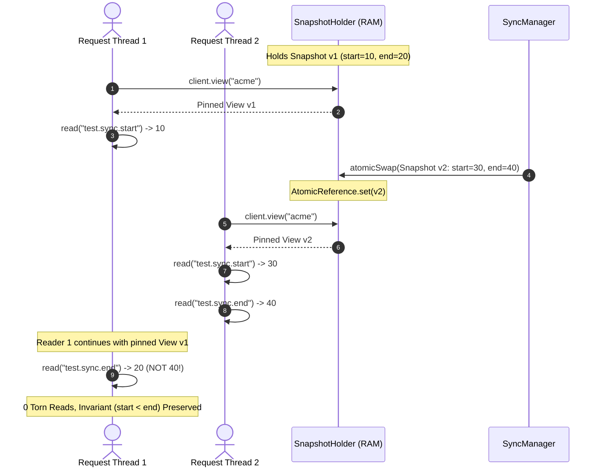
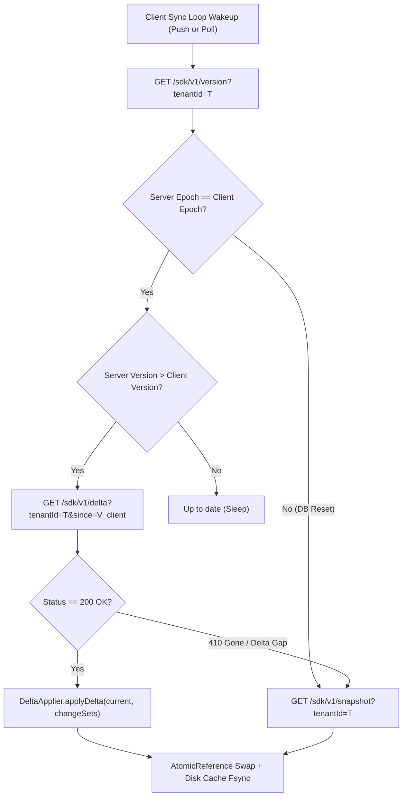

# MoveInSync Hierarchical Tenant Configuration — Consistency Model

This document specifies the formal consistency model, isolation guarantees, and synchronization semantics implemented by the MoveInSync Configuration System.

---

## 1. Versioning Semantics & Strict Monotonicity

### 1.1 Linearizable, Gap-Free Version Numbers
Database sequences in relational databases allocate IDs without guaranteeing commit-order ordering: transaction $T_2$ allocating sequence value 43 can commit before transaction $T_1$ allocating sequence value 42. A polling client reading `since=41` would observe 43, advance its watermark, and permanently miss version 42.

To guarantee **linearizable, commit-ordered, gap-free versioning**, the system maintains a single head record:

```sql
CREATE TABLE config_head (
  id              INT PRIMARY KEY DEFAULT 1,
  current_version BIGINT NOT NULL,
  epoch           UUID NOT NULL,
  updated_at      TIMESTAMPTZ NOT NULL,
  CONSTRAINT single_row CHECK (id = 1)
);
```

On every publish operation:
1. The publisher opens a database transaction and executes:
   ```sql
   SELECT current_version, epoch FROM config_head WHERE id = 1 FOR UPDATE;
   ```
2. The row lock serializes all concurrent publishers globally.
3. The new version is computed deterministically as:
   $$V_{\text{new}} = V_{\text{current}} + 1$$
4. Overrides, change sets, outbox entries, and `config_head` are updated within the same transaction.
5. The commit strictly establishes monotonic total ordering: if $V_b > V_a$, then change set $V_b$ committed strictly after $V_a$.

---

## 2. Tear-Free Snapshot Isolation (`ConfigView`)

A critical requirement in commute configuration is ensuring that interrelated settings are never read in a torn state. For example:
- `booking.window.start` = 06:00
- `booking.window.end` = 22:00
- Invariant: $\text{start} < \text{end}$.

If an update simultaneously changes both values to `(07:00, 23:00)`, a reader must **never** observe `(07:00, 22:00)` or `(06:00, 23:00)`.



### Technical Guarantee
- The SDK stores its in-memory state inside `AtomicReference<ConfigSnapshot>`.
- When `ConfigView view = client.view(tenantId)` is invoked, it pins the exact `ConfigSnapshot` reference active at that instant.
- Subsequent calls to `view.getLong(...)` or `view.getTimeWindow(...)` read exclusively from that immutable reference.
- Concurrent updates swap the `AtomicReference` pointer using volatile write semantics (`atomicReference.set(newSnapshot)`), ensuring that existing views are unaffected while subsequent views observe the latest version.

---

## 3. Watermark Delta Synchronization

Clients track their synchronized state using a tuple:
$$\mathcal{W} = (\text{epoch}, \text{version})$$



### Delta Retention & Gap Handling
- The server maintains a bounded in-memory `ChangeLog` ring buffer containing the most recent 1,000 change sets.
- If a client has been disconnected and its watermark lags beyond the ring buffer capacity, the server responds with:
  ```json
  {
    "status": 410,
    "error": "DELTA_GAP_EXCEEDED",
    "message": "Client watermark version 12 is older than available change log. Full snapshot required."
  }
  ```
- Upon receiving a 410 status code, `SyncManager` immediately falls back to requesting `GET /sdk/v1/snapshot?tenantId=...`, refreshing the entire tenant state without manual intervention.

---

## 4. Server Database Reset & Epoch UUID Recovery

In distributed systems, server databases may be restored from backups, wiped during disaster recovery, or re-initialized in staging environments. If a server is reset:
- The server version may reset from 1,000 back to 0.
- Without an epoch identifier, a client at version 1,000 would believe it is ahead of the server ($1000 > 0$) and ignore all subsequent updates indefinitely.

### Mitigation: Monotonic Epochs
Every database initialization creates a new random `UUID` for `epoch`:
```sql
INSERT INTO config_head (id, current_version, epoch, updated_at)
VALUES (1, 0, gen_random_uuid(), NOW());
```

1. The client persists `(epoch, version)` in its disk cache and in memory.
2. Every version check and SSE handshake transmits the server's current epoch.
3. If `server.epoch != client.epoch`, the client:
   - Discards its stored watermark.
   - Fetches a full snapshot `GET /sdk/v1/snapshot`.
   - Adopts the new epoch and version.
   - Overwrites the disk cache with the new epoch's state.

---

## 5. Summary of Guarantees

| Property | Level | Implementation Mechanism |
|---|---|---|
| **Version Ordering** | Linearizable | `SELECT ... FOR UPDATE` on `config_head` |
| **Read Consistency** | Snapshot Isolation | Immutable `ConfigSnapshot` pinned by `ConfigView` |
| **Write Atomicity** | Atomic ChangeSets | Single DB transaction + Single `AtomicReference.set()` |
| **Cross-Field Safety** | Invariant Checked | `ChangeSetValidator` pre-evaluates candidate snapshot |
| **Disaster Recovery** | Epoch Monotonicity | Server `UUID epoch` resets client watermarks safely |

