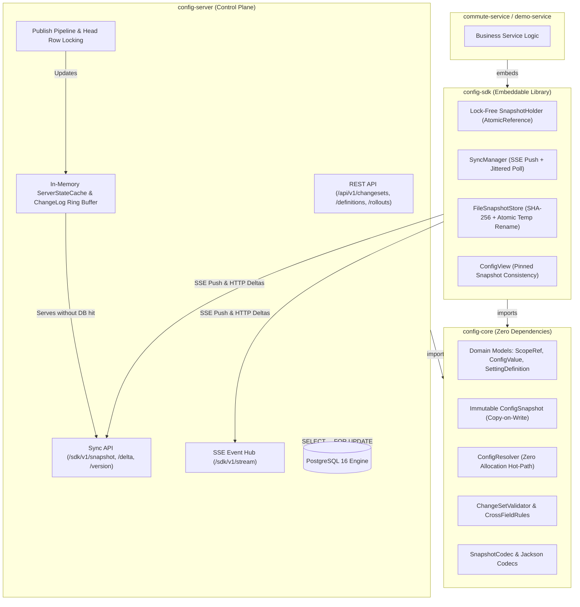
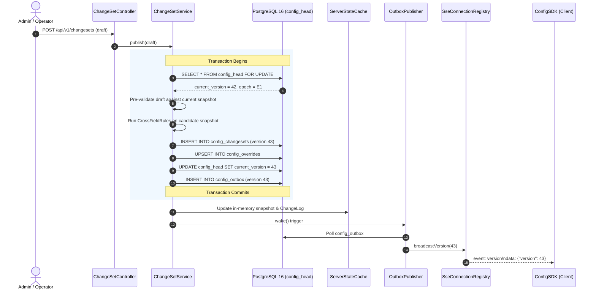
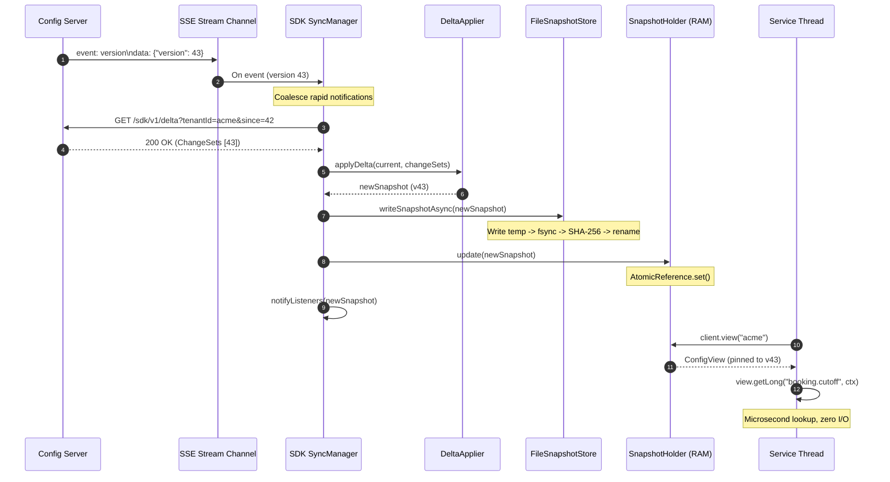

# MoveInSync Hierarchical Tenant Configuration — Design Note

This document outlines the architecture, component boundaries, data flow pipelines, and design decisions behind the **MoveInSync Hierarchical Tenant Configuration Engine**.

---

## 1. System Architecture

The system is decomposed into a Maven multi-module architecture adhering to strict separation of concerns:



### Module Responsibilities

1. **`config-core`**:
   - **Pure Java (Zero Spring, Zero JDBC, Zero HTTP)**. Shared symmetrically by both server and SDK.
   - Contains immutable records (`ScopeRef`, `ConfigContext`, `SettingDefinition`, `ConfigSnapshot`, `ChangeSet`), polymorphic `ConfigValue` hierarchy (`NumberValue`, `DurationValue`, `TimeWindowValue`, `EnumValue`, `ListValue`), `SnapshotCodec`, `ConfigResolver`, and `ChangeSetValidator`.
   - Guarantees identical resolution and validation behavior between control plane and distributed clients.

2. **`config-server`**:
   - Spring Boot 3.3.4 control plane.
   - Manages tenant configuration definitions, overrides, staged rollouts, and rollback operations.
   - Enforces linearizable, gap-free monotonic versioning via `SELECT ... FOR UPDATE` row-locking on `config_head`.
   - Emits SSE notifications carrying **strictly version numbers**.
   - Maintains an in-memory `ServerStateCache` (Caffeine) and an immutable 1,000-entry ring buffer (`ChangeLog`). **Read/sync/delta requests never touch PostgreSQL**.

3. **`config-sdk`**:
   - Ultra-lightweight embeddable Java client depending solely on `config-core`, Jackson, `slf4j-api`, and JDK 21 `java.net.http`.
   - Operates in lock-free memory: local configuration reads take microseconds with zero network I/O, zero database connections, zero locking, and zero garbage allocation on hot paths.
   - Supports atomic snapshot updates, background coalesced delta sync, disk-cache fallback with SHA-256 integrity verification, and automatic epoch-reset recovery.

4. **`demo-service`**:
   - Sample commute management microservice demonstrating integration of `ConfigClient` bean, verifying sub-millisecond local reads, live SSE propagation, explainability traces, and client-side metrics.

---

## 2. Hierarchical Scope Model & Resolution

The configuration hierarchy evaluates scopes from most specific to least specific:

$$\text{SHIFT} \longrightarrow \text{OFFICE} \longrightarrow \text{CLIENT} \longrightarrow \text{GLOBAL} \longrightarrow \text{Definition Default}$$

```mermaid
flowchart TD
    Req["ConfigContext: [client=acme, office=acme/blr-1, shift=acme/blr-1/night]"]
    S0["1. SHIFT: acme/blr-1/night"]
    S1["2. OFFICE: acme/blr-1"]
    S2["3. CLIENT: acme"]
    S3["4. GLOBAL"]
    Def["5. Definition Default"]
    Found["Return Resolved Config"]

    Req --> S0
    S0 -- Override present? -->|Yes| Found
    S0 -- No --> S1
    S1 -- Override present? -->|Yes| Found
    S1 -- No --> S2
    S2 -- Override present? -->|Yes| Found
    S2 -- No --> S3
    S3 -- Override present? -->|Yes| Found
    S3 -- No --> Def
    Def --> Found
```

### Precomputed Scope Chains
To eliminate heap allocations during high-throughput local reads, `ConfigContext` precomputes its lookup chain during construction:
```java
public record ScopeRef(ScopeType type, String id) { ... }

public final class ConfigContext {
    private final ScopeRef[] chain; // Precomputed: [SHIFT, OFFICE, CLIENT, GLOBAL]
    public ScopeRef[] chain() { return chain; }
}
```
During `resolver.resolveValue(snapshot, key, context)`, the resolver inspects the setting's scope map using at most 4 array dereferences and hash-map lookups, falling back to `definition.defaultValue()`.

---

## 3. Publish Pipeline & Linearizable Monotonic Versions

All configuration modifications—whether definition changes, override updates, deletions, staged rollouts, or rollbacks—flow through the atomic publish pipeline.



### Key Guarantees
1. **Single-Row Lock (`config_head`)**: Avoids out-of-order sequence commits. Every version $V_{k+1} = V_k + 1$ is strictly commit-ordered and gap-free.
2. **Atomic Verification**: `ChangeSetValidator` constructs a candidate snapshot using copy-on-write `current.withChangeSet(draft)` and verifies type handlers and all registered `CrossFieldRule` implementations (`StartBeforeEndRule`, `MinLessThanMaxRideTimeRule`, `CutoffWithinLeadTimeRule`) before writing to disk.

---

## 4. Live Propagation Pipeline



---

## 5. Staged Rollouts Architecture

Staged rollouts do not introduce a second resolution engine. Instead, they leverage the existing scope hierarchy:

1. **Stage**:
   - `POST /api/v1/rollouts`: Writes `OFFICE`-level overrides for target offices, tagged with a unique `rollout_id`.
   - Targeted offices immediately resolve the new value; non-targeted sibling offices continue falling back to `CLIENT` or `GLOBAL`.
2. **Promote**:
   - `POST /api/v1/rollouts/{id}/promote`: Writes the target override to the broader scope (e.g. `CLIENT:acme` or `GLOBAL`) and simultaneously deletes the staged `OFFICE` overrides.
   - Sibling offices now seamlessly observe the promoted value without duplicate overrides remaining.
3. **Cancel**:
   - `POST /api/v1/rollouts/{id}/cancel`: Deletes the staged `OFFICE` overrides, immediately restoring target offices to the pre-rollout parent scope value.

---

## 6. Security & Tenant Isolation

- **Authentication**: Stateless HMAC-SHA256 JWT tokens. Claims carry `sub` (service or admin identity), `roles` (`ROLE_ADMIN`, `ROLE_OPERATOR`, `ROLE_SERVICE`), and `tenants` (e.g. `["acme", "globex"]` or `["*"]`).
- **404 Over 403 on Cross-Tenant Access**: When a client requests configuration or delta for a tenant not authorized by their token, the server responds with `404 Not Found` (never `403 Forbidden`). This prevents malicious actors from discovering the existence of other tenants.
- **PII Scrubbing**: All log messages and error bodies pass through `LogSanitizer`, redacting emails, phone numbers, and internal stack traces. Every request is stamped with an `X-Correlation-ID` propagated across MDC logs.

